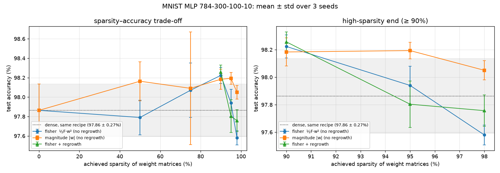

# The Self-Pruning Network

A small neural-network library written from scratch in Python + NumPy (reverse-mode
autodiff, layers, Adam), used to train a classifier that prunes its own connections
during training under a hard sparsity budget.

No PyTorch / TensorFlow / JAX / Keras or any autodiff, pruning or NN library is used.
**scikit-learn is used only to load the MNIST dataset** (`fetch_openml`), never for
training, models or gradients.

## Install

With [uv](https://docs.astral.sh/uv/) (preferred):

```bash
uv venv --python 3.10    # any Python >= 3.10
uv pip install -r requirements.txt
```

Or with plain pip:

```bash
python -m venv .venv
.venv/Scripts/activate        # Windows; use `source .venv/bin/activate` on Linux/macOS
pip install -r requirements.txt
```

## Commands

| What | Command |
|---|---|
| Gradient-check + masked-weight tests (Part 1) | `python -m pytest` |
| Part 2 training (early stopping, ~1 min on CPU) | `python -m train.train_mlp` |
| Evaluate the saved Part 2 model on the test set | `python -m train.test_model` |
| Part 3 self-pruning run (90% sparsity, ~2.5 min) | `python -m train.prune_mlp` |
| Part 4 Pareto sweep (42 runs; ~25 min with 4 parallel CPU jobs) | `python -m train.sweep --jobs 4` |
| Part 4 inference-cost measurement (after the sweep) | `python -m train.cost` |

## Optional: run on an NVIDIA GPU

Every training script accepts `--device gpu`, for example `python -m train.prune_mlp --device gpu`.
It needs CuPy (`uv pip install "cupy-cuda12x[ctk]"`), which provides the NumPy API on CUDA.

- **Same engine on both devices.** Each op takes its array module from its inputs, so
  the engine code is the same on CPU and GPU. Only Adam has a GPU-specific path: the same
  update fused into one kernel, to avoid ~15 kernel launches per parameter.
- **Checked against the CPU.** `tests/test_gpu.py` checks that CPU and GPU training agree
  to ~1e-10, including pruning. It is skipped on machines without CUDA.
- **CPU/NumPy is the reference.** The brief asks for NumPy, and float32 summation order
  differs on the GPU. So all reported numbers come from the default CPU path; GPU runs
  agree to within seed noise.

Measured on an RTX 500 Ada laptop GPU, for one pruning epoch:

| Path | Seconds per epoch |
|---|---|
| CPU, before optimization | 7.2 |
| CPU, optimized | 4.0 |
| GPU | 2.0 |

## Layout

```
engine/   Part 1: Tensor, Parameter (with pruning mask), ops, finite-difference gradcheck
nn/       mask-aware optimizers (SGD+momentum, Adam); layers in Part 2
train/    data loading and training loops (Part 2)
prune/    importance criteria, schedules, mask updates (Part 3)
tests/    gradcheck suite, engine mechanics, masked-weight correctness
```

## Part 1 status

- `Tensor` wraps a NumPy array, records its parents, and stores `.grad`.
- Ops: `+ - * /` (with full broadcasting), `@` (incl. batched), `sum`, `mean`,
  `relu`, `tanh`, `sigmoid`, and fused, numerically stable `softmax_cross_entropy`.
- `backward()` uses an iterative topological sort (no recursion limit) and accumulates
  gradients for re-used nodes; broadcast operands get their gradient summed back to
  their own shape, so `(N, D) + (D,)` gives the bias a column sum.
- Every op is checked against central finite differences (`tests/test_gradcheck.py`).
- Masked weights: see [DESIGN.md](DESIGN.md#the-gradient-of-a-masked-weight) and
  `tests/test_masking.py`.

## Part 2: training a dense MLP

`python -m train.train_mlp` trains a 784-300-100-10 ReLU MLP (LeNet-300-100, 266,610
parameters) on MNIST with the from-scratch Adam (lr 1e-3, batch 128, seed 0). A tqdm bar
shows progress inside each epoch.

**Early stopping:**
- Training runs for at most 1000 epochs.
- It stops once validation loss has not improved by at least `1e-4` for 10 epochs in a
  row (`--patience 10 --min-delta 1e-4`; use `--monitor val_acc` to watch accuracy instead).
- The weights from the best epoch are restored, and only that checkpoint is evaluated on
  the test set. The best epoch is marked on the learning-curve plot.

It writes these files to `results/part2/`:

- `metrics.csv`: per-epoch train/val loss and accuracy, max gradient norm, max |w|
- `learning_curve.png`: the learning-curve plot
- `train.log`, `config.json`, `summary.json`
- `model.npz`: the best checkpoint (not committed)

`python -m train.test_model` reloads that checkpoint and reports:

- test loss and accuracy
- per-class accuracy
- the most common mistake
- `confusion_matrix.png` and `test_report.json`

Early stopping ended the run after 19 epochs. Validation loss was best at epoch 9,
and that checkpoint is the one tested:

| Best checkpoint (epoch 9) | Loss | Accuracy |
|---|---|---|
| Train | 0.019 | 99.34% |
| Validation | 0.084 | 97.68% |
| **Test** | **0.078** | **97.85%** |


- **Data:**
  - MNIST, standard 60k/10k split.
  - 5k of the training images are held out for validation, using a fixed split seed.
  - Pixels are scaled to [0, 1], then standardized with training-set mean/std.
  - The test set is evaluated once, at the end.
- **Initialization: He (Kaiming) normal, `std = sqrt(2 / fan_in)`, biases at 0.**
  - **Why:** for `h = relu(W x)` with zero-mean weights, `Var(Wx) = fan_in · Var(w) · E[x²]`. ReLU keeps half of that second moment. So `Var(w) = 2 / fan_in` keeps the activation scale constant from layer to layer.
  - **Measured on 1,000 training images:** the run logs the std of each hidden layer's output at init:

    | Init | Layer 1 | Layer 2 |
    |---|---|---|
    | He | 0.83 | 0.81 (stable) |
    | Xavier | 0.71 | 0.60 (shrinking with ReLU) |
    | N(0, 0.01²) | 0.17 | 0.02 (vanishing) |
    | N(0, 1) | 16.5 | 196 (exploding) |

  - `tests/test_layers.py` checks the same through 6 ReLU layers.
- **Stability:**
  - The loop stops with an error on the first non-finite loss or gradient, and none occurred.
  - The max global gradient norm settles at ~1.5 after epoch 1. Max |w| grows slowly, from 0.47 to 0.52.
- **Honest note:** validation loss is lowest at epoch 4 (0.090) and then creeps up while training loss keeps falling. That is mild overfitting, because there is no regularization. Validation accuracy stays flat at about 97.3–97.6%.
- **Speed:**
  - Training takes ~2.6 s per epoch on CPU.
  - `OPENBLAS_NUM_THREADS` is pinned to 4 in the entry script. With the default of one thread per core, thread overhead made each small matmul ~200× slower: about 26 s per epoch.
- **Optional W&B tracking (all training scripts):**
  - Install it with `uv pip install wandb`, then run `python -m train.train_mlp --wandb offline`. Offline runs are stored under `results/part2/wandb/`; upload one later with `wandb sync <run dir>`.
  - `--wandb online` logs live, after `wandb login`.
  - Every result above is reproduced without W&B.

## Part 3: the network prunes itself

`python -m train.prune_mlp` trains the same MLP from scratch while it removes 90% of the
weight-matrix connections. Biases (410 values) are not pruned and are reported separately.

- **Importance criterion: `½·F·w²`.** This is the second-order Taylor estimate of the
  loss increase from removing a weight, with the Fisher diagonal recovered from
  mini-batch gradient statistics. It was chosen by measuring how well each candidate
  ranks the true loss increase: Spearman 0.94–0.97, versus 0.82–0.93 for magnitude.
  **Part 4 found that this advantage does not carry over to gradual pruning at high
  sparsity, where magnitude does better.** See the Part 4 section below.
  The derivation and the full comparison are in
  [DESIGN.md](DESIGN.md#importance-criterion).
- **Schedule:**
  - 2 epochs of dense warm-up;
  - a cubic sparsity ramp to the target by epoch 12, with mask updates every 50 steps;
  - fine-tuning with a fixed mask until epoch 20.
- **Global ranking across layers,** with a 1% per-layer floor.
- **Regrowth:** 20% of the kept budget, cosine-decayed to 0, goes to pruned connections
  with the largest gradient. They come back at 0 with fresh Adam state.
- **Honest masking:**
  - pruned weights are exact `0.0` in memory, and the run reports the fraction of
    exact zeros next to the mask sparsity;
  - the masked-weight tests from Part 1 guarantee they stay zero.
- **Options:**
  - `--sparsity 0.95`
  - `--criterion magnitude|taylor1|fisher|taylor2`
  - `--regrow 0` to switch regrowth off
  - `--wandb offline`
- **Outputs,** in `results/part3/`:
  - `pruning_run.png`: loss, accuracy and sparsity against the cubic target
  - `metrics.csv`, `mask_updates.json`, `summary.json`, `train.log`

### Results (seed 0, 20 epochs)

| Run | Sparsity (exact zeros) | Active weights | Layer density (L1 / L2 / L3) | Test accuracy |
|---|---|---|---|---|
| Dense, Part 2 (early-stopped, best epoch 9) | 0% | 266,200 | 100 / 100 / 100% | 97.85% |
| `fisher` + regrowth (`results/part3`) | **90.00%** | 26,620 | 7.6 / 27.0 / 74.2% | **98.34%** |
| `fisher` + regrowth (`results/part3_95`) | **95.00%** | 13,310 | 3.4 / 15.2 / 65.1% | **97.99%** |
| `magnitude`, no regrowth (`results/part3_magnitude`) | 90.00% | 26,620 | 7.9 / 25.2 / 55.8% | 98.27% |

- **The hard budget is met exactly,** and the fraction of weights that are exactly `0.0`
  in memory equals the target.
- **The runs reproduce:** rerunning from a clean start with the same code gives identical
  numbers. (These numbers come from the optimized Adam, which rounds very slightly
  differently from the first version, so they were regenerated.)
- Keeping 1 weight in 20 still gives 98.0% on MNIST.
- The global criterion cuts the 784→300 input layer hardest and keeps most of the
  output layer.

**What these numbers do *not* show yet:**

- **That pruning costs nothing, or that it improves accuracy.** The dense baseline is
  an early-stopped checkpoint, while the pruned models trained for 20 epochs. The fair
  accuracy cost is measured against the same 20-epoch recipe at 0% sparsity, which is
  part of the Part 4 sweep.
- **That `fisher` beats `magnitude`.** At 90% they differ by 7 test images out of
  10,000, from one seed, and the two runs also differ in regrowth. Part 4 compares them
  under identical settings over several seeds and at higher sparsity.
- **That regrowth helps.** It swapped 925k connections (mostly early in the ramp, decaying
  to 0 before fine-tuning). Part 4 runs it on versus off.

## Part 4: evidence

Reproduce with `python -m train.sweep --jobs 4` (42 runs, ~25 min on CPU), then
`python -m train.cost`. Every number below comes from those commands and is committed
in `results/part4/`:

| File | Contents |
|---|---|
| `sweep_runs.csv` | One row per run: the raw numbers |
| `pareto.csv` | Mean / std / min / max per method and sparsity |
| `comparison.csv` / `comparison.md` | Paired per-seed differences with t-tests |
| `pareto.png` | The Pareto plot |
| `cost.csv` / `cost.md` / `cost.png` | The inference-cost measurements |
| `runs/*/` | Each run's log, metrics and mask history |

**Setup:**
- Every run uses the Part 3 recipe on CPU: 20 epochs, 2-epoch warm-up, a cubic ramp to
  epoch 12, then fine-tuning.
- Only the swept arguments change. The two criteria are compared **without regrowth**,
  so the criterion is the only difference between them.
- The 0% point is a dense model trained with the same recipe. That makes it the fair
  baseline, unlike the early-stopped Part 2 model.
- Each configuration runs with seeds 0, 1 and 2. Every run hit its target sparsity
  exactly, with the same fraction of exact zeros in memory.

### Sparsity–accuracy Pareto curve



Test accuracy, mean ± std over 3 seeds:

| Sparsity | Active weights | `fisher` (½F·w²) | `magnitude` (\|w\|) | `fisher` + regrowth |
|---|---|---|---|---|
| 0% (dense, same recipe) | 266,200 | 97.86 ± 0.27 | 97.86 ± 0.27 | — |
| 50% | 133,100 | 97.79 ± 0.18 | 98.16 ± 0.20 | — |
| 75% | 66,550 | 98.07 ± 0.28 | 98.09 ± 0.58 | — |
| 90% | 26,620 | 98.22 ± 0.08 | 98.18 ± 0.10 | 98.26 ± 0.07 |
| 95% | 13,310 | 97.94 ± 0.14 | **98.19 ± 0.06** | 97.80 ± 0.17 |
| 98% | 5,324 | 97.58 ± 0.07 | **98.05 ± 0.07** | 97.76 ± 0.11 |

**What it costs to remove 98% of the connections.** Each pruned run is paired with the
dense run of the same seed:

| | Paired difference from dense | Per-seed differences | Significant? |
|---|---|---|---|
| Magnitude at 98% | +0.19 points | +0.04 / +0.43 / +0.09 | No (t = 1.5) |
| Fisher at 98% | −0.28 points | −0.51 / +0.05 / −0.39 | No (t = −1.7) |

So with magnitude pruning, a 98%-sparse network (50× fewer weights) shows **no
measurable accuracy cost** on MNIST. At 90%, both criteria are slightly *above* the
dense model:

| | Paired difference from dense | Seeds better than dense | t |
|---|---|---|---|
| Magnitude at 90% | +0.32 points | 3 / 3 | 3.1 |
| Fisher at 90% | +0.36 points | 3 / 3 | 3.2 |

Neither 90% result is significant at n = 3 (critical t = 4.30). They are consistent
with pruning acting as a mild regularizer, but they do not establish it.

### Is the importance criterion better than magnitude? No.

These are paired comparisons over seeds 0–2. Since n = 3, df = 2 and the two-sided 95%
critical t is 4.30 (`results/part4/comparison.md`):

| Sparsity | `fisher` − `magnitude` (points) | Fisher wins / losses | t | Real or noise? |
|---|---|---|---|---|
| 50% | −0.37 ± 0.27 | 0 / 3 | −2.4 | Not significant |
| 75% | −0.02 ± 0.85 | 1 / 2 | −0.0 | Noise |
| 90% | +0.04 ± 0.02 | 3 / 0 | 3.5 | Not significant (tiny) |
| 95% | −0.25 ± 0.19 | 0 / 3 | −2.3 | Not significant |
| **98%** | **−0.47 ± 0.09** | **0 / 3** | **−9.5** | **Significant: magnitude is better** |

**The honest answer: no.** The Fisher criterion predicts the damage from removing a
*single* weight better than magnitude does (Part 3: Spearman 0.94–0.97 vs 0.82–0.93).
That advantage does not survive gradual pruning with fine-tuning. Magnitude ties it at
≤ 90% and beats it at 95–98%, with the gap growing with sparsity.

**Not the cause: layer allocation.** Both criteria end up with nearly the same density
in layers 1 and 2 (98%: 1.2 / 6.2% for fisher vs 1.2 / 6.9% for magnitude). The output
layer differs (55% vs 37%), but that is ~180 weights out of 5,324. So the difference is
in *which* weights are kept within a layer. These are hypotheses that have **not**
been tested:

1. **One weight at a time vs many at once.** The diagonal (OBD) estimate scores each
   weight as if it alone were removed. Removing 98% of them at once breaks that
   assumption, and the interactions between weights dominate.
2. **Immediate damage vs recoverability.** With fine-tuning, what matters is how well the
   network can recover after a weight is removed, not the immediate loss jump.
   Magnitude keeps the weights that training itself has been growing, which acts like a
   long-horizon importance signal. Fisher statistics come from a 50-step window.
3. **Noise.** At high sparsity the scores of the marginal weights are close, and the
   mini-batch Fisher estimate is noisy.

Possible next ablations: a longer statistics window or an exponential moving average;
fisher with off-diagonal (K-FAC-style) correction; and a hybrid such as `|w|·√F`.

**Regrowth** (fisher + regrowth vs fisher) gives +0.03, −0.14 and +0.18 points at
90 / 95 / 98%. The t values are all |t| ≤ 1.7, so this is not distinguishable from
noise. It does not hurt stability, and it does not measurably help.

### The falsifiable claim

> **At 98% sparsity (5,324 of 266,200 weight-matrix entries kept), gradual magnitude
> pruning retains 98.05 ± 0.07% MNIST test accuracy, versus 97.58 ± 0.07% for our
> Fisher-saliency criterion, averaged over 3 seeds. Magnitude is better on every
> paired seed (mean +0.47 points, t = 9.5, df = 2).**

The numbers are in `results/part4/sweep_runs.csv` (rows `*_s98_seed{0,1,2}`). The claim
would be falsified by rerunning `python -m train.sweep` with more seeds (`--seeds 0 1 2
3 4 5 6 7 8 9`) and finding that the paired 95% confidence interval for
fisher − magnitude at 98% includes zero or is positive.

### Real cost: does the pruned model do less work?

**The dense-times-zero shortcut is not a speed-up.** Training and the `dense` column
below compute `x @ (W ⊙ M)`. The pruned weights are true zeros, but a dense matmul
still multiplies by them, so its cost is the same at every sparsity. It is included
only as the reference.

Two forward paths were written that actually skip pruned weights (`prune/sparse.py`).
Before timing, both are checked to give **identical predictions** to the dense model on
all 10,000 test images:

- **`csr`:** unstructured sparse. One multiply-add per surviving weight
  (gather + segment-sum).
- **`compact`:** structural. Pruning leaves whole units dead: input pixels with no
  outgoing weights, and hidden units with no inputs or no outputs. These are removed,
  and a constant-output unit is folded into the next layer's bias. What remains is
  smaller dense matrices.

Measured on CPU (NumPy, 4 BLAS threads), using the fisher seed-0 models; the unit is
µs per sample, median of 5 repeats:

| Sparsity | Surviving weights | Compacted shape | Memory KB: dense / CSR / compact | Batch 1: dense / csr / compact | Batch 1024: dense / csr / compact |
|---|---|---|---|---|---|
| 0% | 266,200 | 784→300→100→10 | 1041 / 2083 / 1048 | 19.3 / 1144 / 22.8 | 3.59 / 1291 / 3.92 |
| 90% | 26,620 | 648→264→91→10 | 1041 / 211 / 772 | 19.6 / 98.5 / 23.7 | 3.67 / 99.8 / 3.31 |
| 95% | 13,310 | 460→209→89→10 | 1041 / 107 / 456 | 20.4 / 65.3 / 17.7 | 3.44 / 70.1 / 2.15 |
| 98% | 5,324 | 381→119→86→10 | 1041 / 45 / 224 | 18.4 / 43.2 / 14.9 | 3.50 / 48.7 / **1.28** |

The full table, including batch 64, is in `results/part4/cost.md`; the plot is in
`cost.png`.

- **FLOPs and parameters:** at 98%, multiply-adds per sample drop 50× (266,200 →
  5,324). Weight memory drops 23× in CSR (1,041 KB → 45 KB).
- **Structural compaction is a real speed-up.** At 98%:
  - batch 1024: **2.7×** faster per sample (3.50 → 1.28 µs; the dense timing is stable at
    3.4–3.8 µs across runs);
  - batch 64: **2.0–2.7×**, because the dense batch-64 timing varied from 4.0 to 6.2 µs
    between runs.

  At 95% and batch 1024 it is 1.6× faster. About half of the input pixels (the MNIST
  border) and 60% of the first hidden layer end up with no surviving connections, so
  they are physically removed.
- **Our unstructured CSR path is *slower* than dense at every sparsity tested,** by 2.3×
  at 98% and batch 1, and much more at large batches. It does 50× fewer multiply-adds,
  but the work is gathers and segmented sums driven from Python/NumPy. BLAS runs a dense
  matmul at close to peak arithmetic throughput, so it wins below very high sparsity
  or without a compiled sparse kernel. We report it rather than hide it.
- At batch 1, every path is dominated by fixed per-call overhead of ~15–20 µs, which
  limits any gain to about 1.2×.
